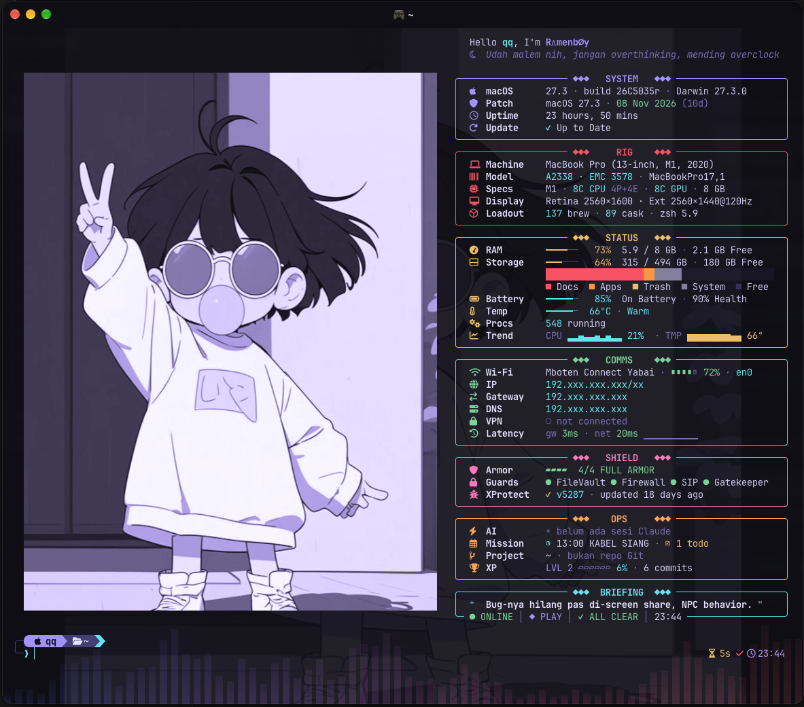
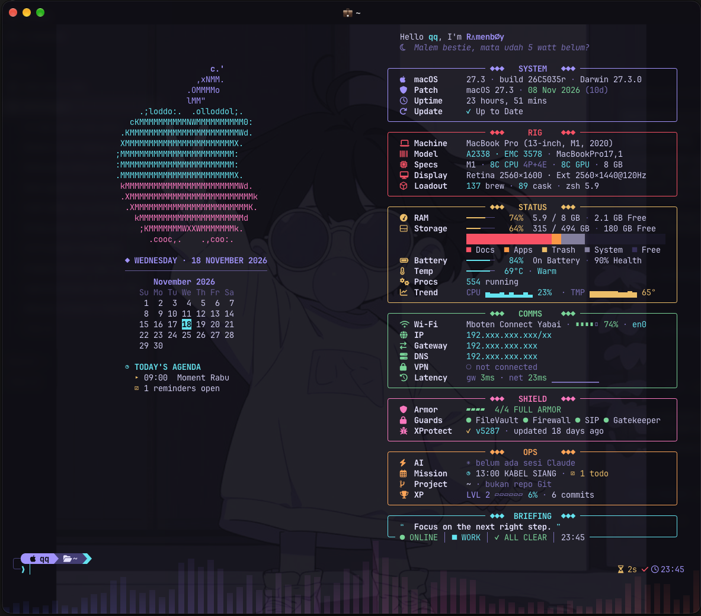

# Sugeng Slay

Sugeng rawuh, bestie. Kalau Shell Senpai adalah markas saya di Windows, maka Sugeng Slay adalah kokpit saya di macOS. Namanya gabungan dari sugeng, sapaan hangat khas Jawa untuk menyambut tamu, dan slay, istilah gen z untuk sesuatu yang tampil maksimal. Setiap kali terminal dibuka, rasanya seperti masuk ke HUD game cyberpunk yang tahu semua hal tentang laptop kamu.

Edisi ketiga ini saya sebut Cockpit Edition. Kalau versi Windows terasa seperti code editor, Sugeng Slay sengaja dibangun dengan bahasa visual game: ada kartu RIG, COMMS, SHIELD, dan OPS, ada armor, ada level dan XP, sampai launch sequence setiap kali membuka asisten AI. Repo ini berisi seluruh dotfiles untuk Ghostty di macOS, jadi kalau MacBook harus diinstal ulang, cukup clone repo ini dan semuanya kembali menyala dalam beberapa menit.

## Preview

Mode play menampilkan foto karakter bernuansa lavender di samping panel, lengkap dengan quote santai di kartu BRIEFING.



Mode work mengganti foto dengan logo Apple, kalender bulan berjalan, dan agenda hari ini, ditemani quote motivasi kerja. Mode ini bisa menyala otomatis mengikuti macOS Focus.



## Tentang Edisi Ini

Sugeng Slay bukan aplikasi baru, melainkan kumpulan konfigurasi yang menyatukan beberapa tools open source menjadi satu kokpit yang konsisten. Ghostty dipakai karena mendukung gambar, warna 24 bit, dan shader GPU. Fastfetch menggambar panel, Starship mengurus prompt, sedangkan semua data dikumpulkan oleh script zsh bernama hud.sh. Sebuah sampler kecil berjalan di background lewat launchd setiap enam puluh detik untuk mencatat CPU, suhu, dan ping, sehingga panel tetap terbuka instan walaupun isinya padat.

Prinsip yang saya pegang tetap sama dengan versi Windows, yaitu informasi harus terbaca sekilas dan tidak boleh mengorbankan privasi. Semua alamat IP otomatis disamarkan, setiap kartu punya warna identitas sendiri, dan semua peringatan dikumpulkan di satu dock di bagian bawah supaya mata tidak perlu mencari.

## Fitur Unggulan

| Fitur | Penjelasan |
|---|---|
| Boot Sequence | Animasi CYBERDECK ADMIN ACCESS GRANTED setiap kali terminal dibuka |
| Kartu SYSTEM | Versi macOS, build, kernel, security patch terakhir beserta umurnya, dan status update |
| Kartu RIG | Model lengkap dengan A-number dan EMC, chip beserta komposisi core, GPU, memori, dan semua layar yang terhubung, terdeteksi otomatis |
| Kartu STATUS | RAM, storage dengan bar bersegmen ala System Settings, baterai, suhu dengan ambang khusus M1, jumlah proses, dan sparkline tren CPU serta suhu |
| Kartu COMMS | Nama Wi-Fi dengan kekuatan sinyal, IP tersamar, gateway, DNS, VPN, dan latency live ke gateway dan internet |
| Kartu SHIELD | Armor empat lapis dari FileVault, Firewall, SIP, dan Gatekeeper, plus versi XProtect |
| Kartu OPS | Sisa kuota Claude lima jam dan tujuh hari, meeting berikutnya dari Calendar, reminder yang belum selesai, status repo Git, serta level XP dan streak commit harian |
| BRIEFING Dock | Quote yang selalu terlihat tepat di atas prompt, menyatu dengan status online, mode, alert, lagu yang diputar, dan jam |
| Mode Work dan Play | Berganti otomatis mengikuti macOS Focus, atau manual dengan perintah work dan play, lengkap dengan ikon tab yang ikut berubah |
| Launcher AI | Perintah claude dan agy membuka tab baru dengan launch sequence, judul tab sendiri, dan otomatis kembali ke tab asal saat keluar |
| Statusline Claude | Model, effort, branch, perubahan baris, durasi sesi, serta bar context dan kuota |
| Equalizer dan Now Playing | Equalizer samar di background dan judul lagu di title bar |
| Perintah Harian | loadout untuk tampilan ringkas atau lengkap, myip, hud untuk membuka btop di split, dan slay-release untuk merilis ke GitHub |

## Instalasi

Pastikan Homebrew sudah terpasang, lalu clone repo ini dan jalankan installer. Sertakan path gambar karakter favoritmu supaya mode play langsung punya foto. Tanpa gambar, dashboard otomatis memakai mode work.

```bash
git clone https://github.com/NullIvy/sugeng-slay.git && cd sugeng-slay
./install.sh ~/Pictures/karakter.jpg
```

Installer memasang semua dependensi, membackup konfigurasi lama, menyalin dotfiles, mengatur zsh dan statusline Claude Code, serta memasang sampler background. Setelah selesai, beri Full Disk Access untuk Ghostty di System Settings, izinkan Calendar dan Reminders saat diminta, lalu tutup Ghostty dengan Cmd Q dan buka kembali.

## Cara Pakai

Secara bawaan mode mengikuti macOS Focus, jadi saat Focus Work menyala panel otomatis berganti ke mode kerja. Perintah work dan play memaksa mode tertentu, dan focus mengembalikannya ke otomatis. Ketik loadout full untuk melihat semua detail hardware dan loadout untuk kembali ke tampilan ringkas. Kalau butuh melihat IP asli, misalnya saat praktikum jaringan, jalankan SLAY_SHOW_IP=1 clear atau myip. Perintah claude dan agy membuka asisten AI di tab baru, dan setelah selesai cukup ketik exit untuk kembali.

## Penutup

Sugeng Slay lahir dari banyak malam ngoprek dan trial and error, mulai dari kode warna yang tampil mentah, foto yang menutupi aplikasi lain, sampai ruang kosong yang membuat tampilan timpang. Kalau kamu menemukan bug atau punya ide untuk membuatnya lebih keren, silakan buka issue atau kirim pull request, karena party yang lengkap selalu lebih seru daripada solo queue. Kredit sepenuhnya untuk para pembuat Ghostty, Fastfetch, Starship, eza, zoxide, fzf, bat, delta, btop, cava, BlackHole, media-control, icalBuddy, dan semua plugin zsh yang ikut membuat terminal ini slay.

Digarap di antara jam satu dan tiga pagi dengan secangkir kopi oleh NullIvy. Matur nuwun, bestie. GG and have fun.
